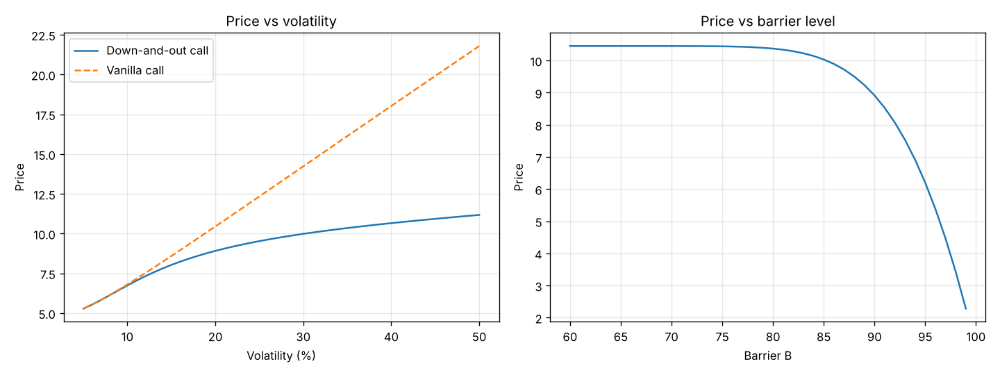

# Barrier Option Pricing

Pricing of a **European down-and-out call** (the option disappears if the underlying
touches the barrier before maturity).

## Method

- **Monte Carlo**: geometric Brownian motion, vectorised with NumPy, daily barrier
  monitoring, price reported with its 95% confidence interval.
- **Validation**: closed-form price for a continuously monitored barrier.
- **Discrete monitoring**: the Broadie-Glasserman-Kou correction shifts the barrier by
  `exp(-0.5826 · σ · √Δt)` to approximate daily monitoring with the closed form.
- **Sensitivities**: price as a function of volatility and of the barrier level.

## Results (S0 = 100, K = 100, B = 90, T = 1, r = 5%, σ = 20%)

| Method | Price |
|---|---|
| Monte Carlo, 100,000 paths, daily monitoring | 8.96 (95% CI 8.87 – 9.06) |
| Closed form with BGK correction (daily monitoring) | 8.91 |
| Closed form, continuous monitoring | 8.67 |
| Vanilla Black-Scholes call | 10.45 |

The Monte Carlo price matches the corrected closed form within its confidence interval.
Continuous monitoring gives a lower price, because the barrier can be hit between two
daily observations. Unlike a vanilla call, the barrier option gains little value when
volatility rises, because higher volatility also raises the probability of knock-out.



## Run

```bash
python pricing_barrier_option.py            # prints prices, saves the charts
python pricing_barrier_option.py --show     # also displays the charts
python pricing_barrier_option.py --paths 500000
```
